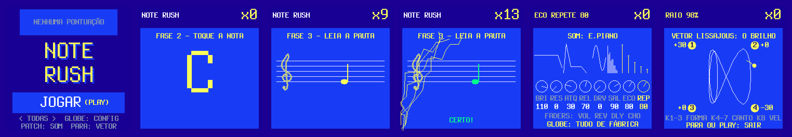
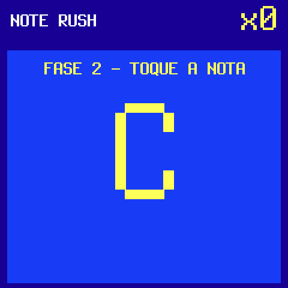
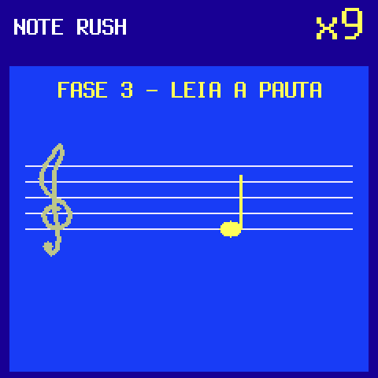
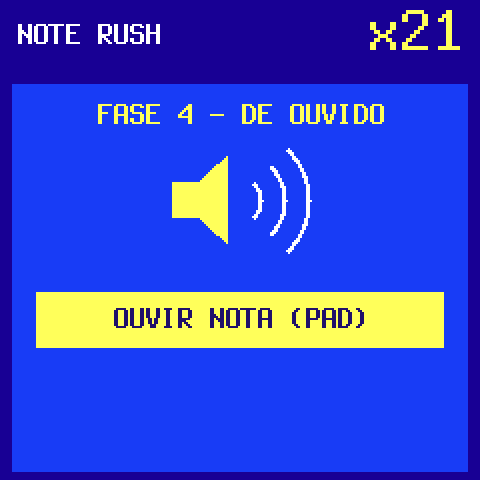
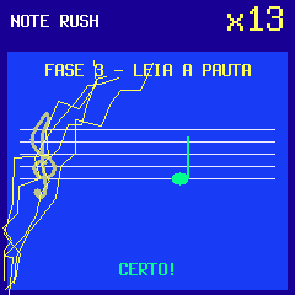
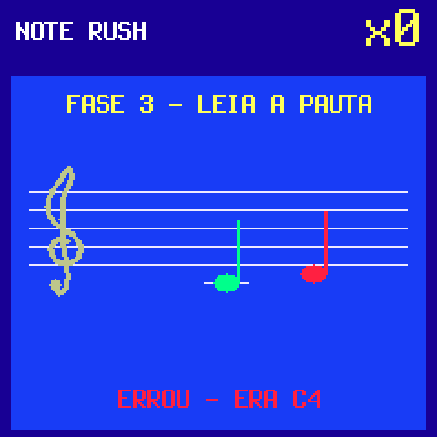
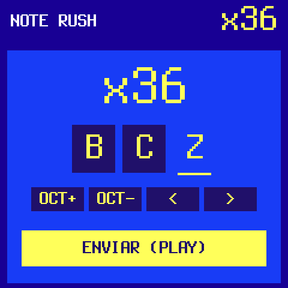
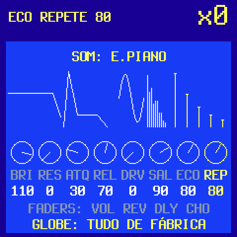
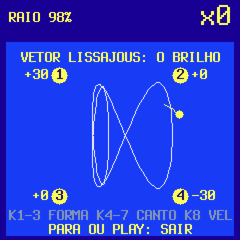
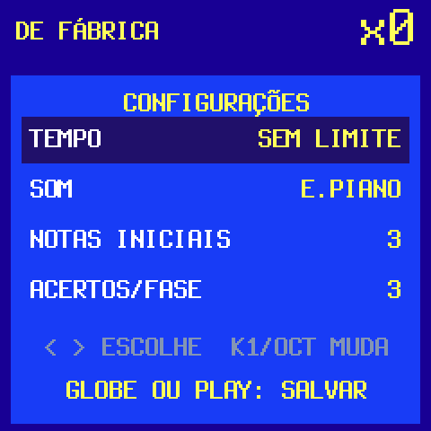

<p align="center"></p>

# NOTE RUSH 37

**Watch it:** [on YouTube](https://youtube.com/shorts/pjCsZ0zWJfI) (in Portuguese) · **Try it:** [in your browser](https://ueinegoms.github.io/noterush37/) (the firmware itself, compiled to WebAssembly, on
a simulated SMK-37; the same page installs it on your keyboard) · **Install:** [below](#install)

**A note-reading game for the M-Vave SMK-37** (Elite, Pro, MKE-P37): the firmware version of
[NOTE RUSH CYBERFUNK](https://ueinegoms.github.io/note-rush-cyberfunk/), a web game (play it there too). A note is shown (its letter, or on the staff) or played, and you play it on the keys; right answers build a
combo, with lightning from the screen across the pads; a wrong key or the time out ends the run, and your score goes
on the keyboard's own top 5. New notes come in as you go: the middle octave first, then the upper, the lower last.
The keys always sound (nine sounds, all of Vector37's engine), and every knob, fader and wheel plays with the sound.
The screens are in Brazilian Portuguese.

A fork of [Vector37](https://github.com/genkigenki/Vector37) by genkigenki: its board layer, its update path and its
synth engine; the game in place of its interface. Unofficial firmware, not affiliated with or endorsed by M-Vave.
Install at your own risk.

## Play

| | | |
|---|---|---|
|  |  |  |
| **NOME**: the letter alone (C .. B): play it, any octave (+3) | **PAUTA**: the staff alone (C3 .. C6): play that very key (+4) | **OUVIDO**: the note heard: play it, any octave (+5); a pad plays it again |

FASE 1 (MEMORIZE) shows each new note, its name and its place on the staff, and plays it. Three right in a row (the
setting ACERTOS/FASE) move on to the next phase; after OUVIDO a new note comes in. Mode TODAS runs the phases in
turn; NOME, PAUTA or OUVIDO alone also work (the title's < >). The time: 6 s by default, from SEM LIMITE (none) to
2 s, as the web version.

| | | |
|---|---|---|
|  |  |  |
| A right answer: lightning from the bottom left corner to the combo, on across the pads (bolts too while a combo runs) | Game over: the right note, the one played | A place in the top 5: three letters, arcade style |

## Controls

| | |
|---|---|
| Keys | always play; answer when asked |
| SEQ PLAY | home: from any screen to the title; on the title it starts a game; naming the score it sends |
| < > | the mode (title), the row (settings), the letter's place (name) |
| OCT- OCT+ | the value (settings), the letter (name) |
| Pads | the OUVIDO note again; they light with the lightning |
| PATCH | the sound: its eight knobs, drawn |
| GLOBE | the settings: TEMPO, SOM (nine sounds), NOTAS INICIAIS, ACERTOS/FASE |
| PARA | the VETOR (in, and out again) |
| K1 .. K8 | BRILHO, RESSONÂNCIA, ATAQUE, RELEASE, DRIVE, SALA, ECO TEMPO, ECO REPETE |
| Faders | VOLUME, REVERB, DELAY, CHORUS |
| Pitch wheel | a bend |
| Mod wheel | lightning on the VETOR's point |

What you set with the knobs and faders goes along from sound to sound (and is kept); what you never touched stays
each sound's own. On the PATCH screen GLOBE puts every sound back as it comes. The same key at the same velocity sounds
the same each time (Vector37's orbit restarts with each note).

| | | |
|---|---|---|
|  |  |  |
| **PATCH**: K1 .. K8 as they sit on the keyboard, each drawn in 1 px lines: the filter, the envelope, the drive, the room, the echoes | **PARA**: the VETOR, a Lissajous running round the four corners, each a brightness: where its point is, their brightness moves the sound's filter (and nothing else). K1 .. K3 the figure, K4 .. K7 the corners (at 0 it changes nothing), K8 its speed | **GLOBE**: the settings, kept in flash with the ranking |

## Install

The SMK-37 Elite takes `noterush37-elite.fwsc`, the SMK-37 Pro `noterush37.fwsc`, the MKE-P37 `noterush37-mke.fwsc`
(one keyboard under three names; the package is the model's).

- **Browser** (Chrome or Edge): connect the keyboard by USB (a data cable), open the
  [simulator page](https://ueinegoms.github.io/noterush37/), CONECTAR (it shows the model and what it runs), INSTALAR (the
  package for that model).
- **Python** (mido, python-rtmidi): `python tools/fm1_install.py --yes noterush37-elite.fwsc`

Installing clears another firmware's stored data on the keyboard (and the other way round). To go back to the stock
firmware, or to another one, install it the same way (the keyboard's USB port is "NoteRush SMK37": the installers find
it, [genkigenki's](https://genkigenki.github.io/smk37/) too). Rescue: hold OCT- while switching on.

## Build

```
sh tools/get_toolchain.sh          # the JieLi toolchain (Linux x86-64) into ~/.jieli
                                   # and JieLi's AC79 SDK V1.2.1 (its tools) in ~/fw-AC79_AIoT_SDK:
                                   # gitee.com/Jieli-Tech/fw-AC79_AIoT_SDK, tag AC79NN_SDK_V1.2.1_2023-12-13
MODEL=elite sh build.sh            # build/noterush37-elite.fwsc (pro: the default; mke)
sh tests/run_tests.sh              # the game played on the host, the engine, the board layer, the installer
sh web/sim/build.sh                # the simulator (Emscripten, or clang + wasm-ld alone): build/sim
sh tools/site.sh                   # the site in docs/ (GitHub Pages): the simulator, the packages, the screenshots
```

The game is `firmware/src/game.c` (the rules, the controls, the LEDs) and `firmware/src/gdraw.c` (the screen); the
installer for the browser is `web/sim/install.js` (a port of `tools/fm1_install.py`).

## Credits

NOTE RUSH 37 by ueine, inspired by and based on [NOTE RUSH CYBERFUNK](https://ueinegoms.github.io/note-rush-cyberfunk/), ueine's web game.
Built on [Vector37](https://github.com/genkigenki/Vector37) by genkigenki (M. Geisler): the synth engine (inspired by the
Beetlecrab Vector), the simulator, the SMK-37's board layer and installer. Board layer from SLOOP by isod89, based on
Felucca by Leo Kuroshita. Master stage after Melodee by Kerem Kilic. Plate after J. Dattorro, "Effect Design 1" (1997).
Terminus font (SIL OFL 1.1).

Licence: GPL-3.0 (see [LICENSE](LICENSE)).

---

**Em português:** um jogo de leitura de notas pro M-Vave SMK-37 (Elite, Pro, MKE-P37), a versão em firmware do
[NOTE RUSH CYBERFUNK](https://ueinegoms.github.io/note-rush-cyberfunk/). Leia a letra, leia a pauta ou ouça a nota e toque no teclado; acerto faz combo (com raio da tela pros
pads), erro ou tempo esgotado encerra, e o seu placar vai pro top 5 do próprio teclado. Veja o
[vídeo](https://youtube.com/shorts/pjCsZ0zWJfI), teste no
[navegador](https://ueinegoms.github.io/noterush37/) e instale pela mesma página (Chrome ou Edge: CONECTAR, INSTALAR).
Firmware não oficial, por sua conta e risco; resgate: segure OCT- ao ligar.
